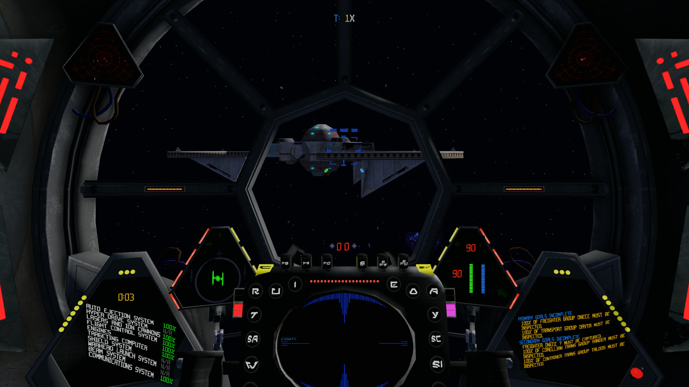
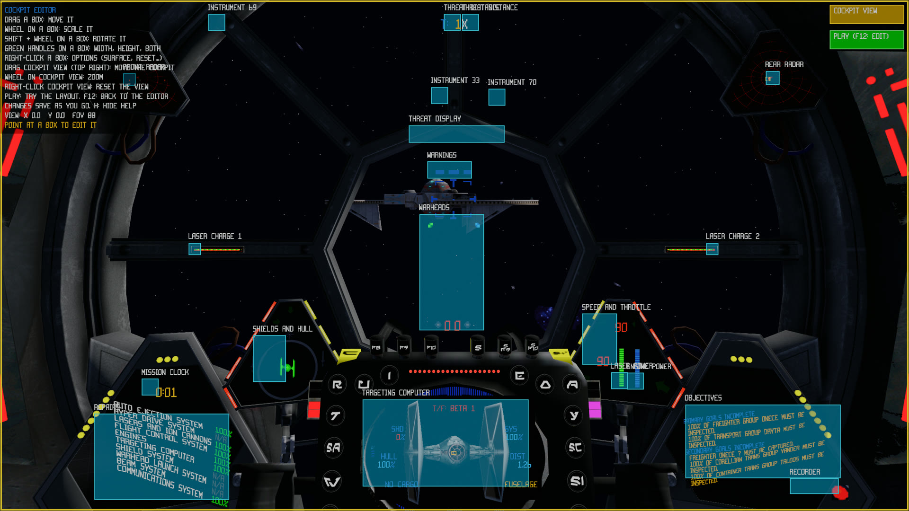

# OpenTIE

OpenTIE is an open-source reimplementation of *Star Wars: TIE Fighter* for
Windows, macOS, and Linux. It runs the original game data natively on current
systems, combining the 1995 Collector's CD-ROM menus, cutscenes, and adaptive
iMUSE soundtrack with the 1998 Windows release's flight simulation and 3D
assets.

> [!IMPORTANT]
> OpenTIE does not include any content from the original game. A complete
> installation of both the 1995 Collector's CD-ROM and the 1998 Windows release
> is required.
>
> *Star Wars: TIE Fighter Special Edition* is available from
> [GOG](https://www.gog.com/en/game/star_wars_tie_fighter_special_edition) and
> [Steam](https://store.steampowered.com/app/355250/STAR_WARS_TIE_Fighter_Special_Edition/).

## The best of both editions

The 1995 and 1998 releases each have their own presentation, flight simulation,
and soundtrack. OpenTIE always combines:

- the 1995 menus and cutscenes
- the 1998 flight simulation and 3D assets
- the adaptive 1995 iMUSE soundtrack

This retains the 1998 flight presentation without giving up the interactive
music of the Collector's CD-ROM. The menu, cutscene, and flight engine
selections are fixed and cannot be switched in the settings.

## Adaptive music

OpenTIE reimplements the adaptive iMUSE soundtrack from the 1995 Collector's
CD-ROM. The music responds to mission events and moves seamlessly between
themes during flight.

OpenTIE can emulate Roland SC-55 Sound Canvas, the hardware for which the game’s
music was originally composed. This requires compatible SC-55 ROMs supplied by
the user.

Built-in Sound Blaster-compatible OPL3 emulation is available for the classic
FM-synth sound, while FluidSynth can play the soundtrack with a user-selected
SoundFont.

The original prerecorded TIE98 music remains available when the complete 1998
experience is preferred.

## Graphics

OpenTIE renders flight with a modern graphics pipeline that combines the
original models and cockpit artwork with high-resolution rendering and
substantially more advanced lighting.

Modern graphics include:

- shadows, ambient occlusion, and bloom
- motion blur
- MSAA and AMD FidelityFX FSR 3.1.4 anti-aliasing and upscaling
- HDR output

Two flight display options are available under **Settings > Video > Display**:

- **TFTC Cockpits** renders flight at 16:9 and replaces the cockpit artwork with a
  3D cockpit model. It is off by default.
- **Centered Messages** shows flight messages in the middle of the screen and
  removes the bottom message bar. It is on by default.

The classic (original renderer) view is disabled; `TAB` no longer switches to it.

### TFTC cockpit models

OpenTIE does not ship the cockpit models. With TFTC Cockpits on, it loads XWA-format cockpit OPTs from
`resources/cockpit3d/` next to `OpenTIE.exe`, named `TieFighterCockpit.opt`, `TieInterceptorCockpit.opt`,
`TieBomberCockpit.opt`, `TieAdvancedX1Cockpit.opt`, `TieDefenderCockpit.opt`, `AssaultGunboatCockpit.opt` and
`MissileBoatCockpit.opt`. A craft without a model keeps the cockpit artwork. The models are drawn only with the
HD flight models, and the first flight with each one takes several seconds to load.

With a TFTC cockpit the HUD gains two panels: **Objectives**, the mission goals screen's text, and **Repairs**,
the damage-control readout. The targeting computer draws without a background, so the target sits on the
cockpit's own screen.

*The X-Wing Alliance Upgrade TIE fighter cockpit by DTM (not included with OpenTIE) with an edited HUD: the
Repairs and Objectives panels drawn onto the side consoles, and the targeting computer without a background.*

### Cockpit editor

The cockpit editor lays out the HUD over a TFTC cockpit. Start it with `--cockpit-editor` (with
`--skip-to-mission <pilot>` to go straight into flight; the launch configuration "OpenTIE (Release, cockpit
editor)" does both). Once the cockpit is on screen the editor selects a target, so the targeting computer has
something to show, and pauses the game. An on-screen panel lists the controls (`H` hides it):

| Control | Effect |
|---|---|
| Drag a box | Moves that HUD element or group |
| Mouse wheel on a box | Scales it; `Shift` + wheel rotates it |
| Green handles on a box | Right edge sets the width, bottom edge the height, corner both |
| Right-click a box | Menu: match surface, reset size, reset all; for Objectives also word wrap and headings |
| Drag **COCKPIT VIEW** (top right) | Slides the cockpit model; mouse wheel on it zooms, right-click resets the view |
| **PLAY** (under COCKPIT VIEW) | Resumes the game to try the layout; `F12` returns to the editor |

*The cockpit editor: the help panel (top left), a labelled box over each HUD element, and the COCKPIT VIEW and
PLAY controls (top right).*

**Match surface** draws an element as if printed on the cockpit surface behind its centre: the element is
rendered to a texture and projected onto that surface's plane. The 3D view inside the targeting computer stays
flat. On the Objectives panel the handles set its wrap width and visible height and the wheel scales its text.

Changes save as they are made to `resources/cockpit3d/<Model>.hud.yaml` beside the cockpit model (for example
`TieFighterCockpit.hud.yaml`), and the layout is used whenever that cockpit is flown. The file holds the view
(cockpit slide and field of view), the Objectives options, and per element an offset in pixels of the
640x480 cockpit frame, a horizontal and vertical scale, an angle and whether it matches the surface.

## Smoother flight

Flight simulation can update at up to 240 Hz to match modern high-refresh-rate
displays, providing smoother motion and more responsive controls. The original
TIE95 and TIE98 timing modes remain available when their exact behavior is
preferred.

Flight can be played with a mouse and keyboard, gamepad, or joystick. Mouse
flight offers both classic controls and a virtual stick, with adjustable
sensitivity and Y-axis inversion.

## Getting started

1. Download the latest package for your platform from
   [GitHub Releases](https://github.com/elyosh/OpenTIE/releases/latest).
2. Extract or install the package and launch OpenTIE.
3. Select the complete TIE95 and TIE98 installation folders when prompted.

OpenTIE validates the selected installations, remembers them for future
launches, and imports compatible existing pilot files during initial setup.

To access OpenTIE settings from the concourse, press `ESC` and select
**OpenTIE Settings**. During flight, press `ESC` to open them directly.

## Supported platforms

| Platform | Target | Graphics backend |
|---|---|---|
| Windows | x86-64 | Direct3D 12 or Vulkan |
| macOS | macOS 13 or later; arm64 or x86-64 | Metal |
| Linux | x86-64; glibc 2.35 or later | Vulkan |

## Current state

OpenTIE remains under active development. Bugs and differences from the
original releases are still possible.

## OpenXWA

Fans of Totally Games’ space simulators may also be interested in
[OpenXWA](https://github.com/elyosh/OpenXWA), an open-source reimplementation
of *Star Wars: X-Wing Alliance* for Windows, macOS, and Linux.

## Community

Join the [TotallyOpen Discord server](https://discord.gg/WBvYzczWfG) to discuss
OpenTIE, OpenXWA, development, and the Totally Games flight simulators.

## System requirements

- a 64-bit system with a modern GPU
- a complete installation of the 1995 Collector's CD-ROM or the 1998 Windows
  release

Release packages include the required runtime libraries. Keep the executable,
libraries, resources, and shader directories together when moving an
installation.

## Building from source

The build requires CMake 3.23 or later, a C/C++ toolchain, SDL3 3.4, zstd,
FFmpeg, and SDL_shadercross. Release packaging pins its dependencies, including
SDL3 3.4.14, and provides the reference for reproducible builds.

Platform-specific instructions are available for
[Windows](packaging/windows/README.md),
[macOS](packaging/macos/README.md), and
[Linux](packaging/linux/README.md).

### Windows native build with MSYS2

The Docker package build is the reference. For day-to-day development on
Windows, OpenTIE also builds natively with the MSYS2 UCRT64 toolchain:

1. Install MSYS2 and, from a UCRT64 shell, the packages `gcc`, `cmake`,
   `ninja`, `pkgconf`, `sdl3`, `zstd`, `ffmpeg`, `fluidsynth`, `speexdsp`, and
   `gdb` (prefixed `mingw-w64-ucrt-x86_64-`).
2. Build SDL_shadercross with its patch from
   `packaging/common/shadercross-fsr3.patch` and the Windows DirectX Shader
   Compiler binaries. MSYS2 does not package it.
3. Configure with `-DAERON_SHADERCROSS_EXECUTABLE=<path to shadercross.exe>`
   and build the `tie` target. A recent GCC may also need a force-included
   header that declares `swprintf_s` and includes `<new>` for the FSR3 sources.

`.vscode/tasks.json` and `.vscode/launch.json` expect the build script and
dependency prefix at `D:/development/OpenTIE-deps`; adjust the paths for your
machine.

### Developer options

| Option | Effect |
|---|---|
| `--skip-to-mission <pilot>` | Loads the named pilot and starts their current tour battle mission, skipping the menus |
| `--headless` | Creates a hidden window, treats it as always focused, and discards audio |
| `--capture <file.png> [seconds]` | Saves the flight view as a PNG once flight has run for the given time (default 6), then quits |
| `--cockpit-editor` | Opens the cockpit editor once a TFTC cockpit is on screen (see [Cockpit editor](#cockpit-editor)) |

For example, `OpenTIE.exe --headless --skip-to-mission PILOT --capture view.png 3`
saves a flight frame without opening a window.
